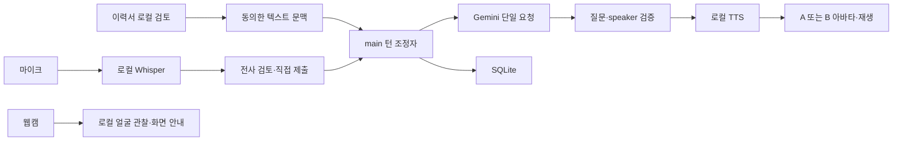

# 아키텍처와 제품 로드맵

## 방향 재정립 — Phase 0 설계안

2026-10-22 KST 현재 채팅의 사용자 첨부 「프로젝트 방향 재정립 및 전체 리팩터링」과 재개 지시를 기준으로 한다. 목표는 **Gemini 텍스트 API + 두 면접관 + 무료 로컬 음성·아바타·웹캠**을 사용하는 Windows 면접 시뮬레이터다. 과거의 “로컬 모델은 도입하지 않는다”는 결정은 새 목표에서 STT/TTS에 한해 재검토한다. 질문·평가용 로컬 LLM은 추가하지 않는다.

**이번 범위는 현재 구현 분석과 문서 변경안이다. Phase 1–7은 설계 초안이며 구현·활성화 승인이 아니다.** 실제 유료 호출, 개인 자료 전송 확대, 모델 다운로드·실행, 카메라 허용, 의존성·CI·자동화 정책 변경, 공개 release를 수행하지 않는다. 상세 요구사항·AC는 [리팩터링 스펙](specs/gemini-local-interview.md), 데이터·실행 경계는 [security](security.md#로컬-음성화상-면접의-목표-보안-설계--미활성)를 따른다.

## 현재 구현 — main f908ca4 기준

| 영역 | 실제 동작과 근거 | 다음 설계와 차이 |
| --- | --- | --- |
| Electron / React / strict TypeScript / Vite | main·sandbox CJS preload·renderer 별도 번들, Windows portable | 기반 유지, 별도 backend/DB 서버 없음 |
| 이력서 | native dialog의 PDF/DOCX 한 개 → 제한 읽기 → sandbox worker 추출·검토; resume.ts, renderer resume/ | 추출·근거·사용자 수정본 재사용, 원문 전체 자동 전송 금지 |
| 질문 | external-ai.ts의 OpenAI·Claude·Gemini REST; AIQuestionProvider의 근거 검증·취소 | 두 면접관, speakerId, 공유 문맥·사용량 계측 없음 |
| 기록 | 내장 node:sqlite, schema 2; 순서·중복·rollback·복원·삭제 | speaker/프로필·사용량·리포트 추가 시 보존형 migration 필요 |
| 음성 | VoiceService의 OpenAI 전사, SpeechService의 OpenAI MP3; 수동 동의·검토·제출 | 로컬 STT/TTS·실시간 턴·VAD·끼어들기 없음 |
| 장치·화면 | 사용자 시작 후 한시적 audio-only 마이크; 한국어·테마·설정 dialog | 카메라·얼굴 분석·두 아바타·결과 평가 미구현 |
| 설정 | LocalSettings, 테마·서비스별 모델·선택한 키의 OS 보호 보관 | 음성 모델/voice·장치·면접관 프로필 보존 없음 |

개발 자동화 상태와 앱 기능의 검증은 분리한다. 현재 소스에서 확인한 호출·보존 범위와 변경 후보는 [Phase 0 분석](specs/gemini-local-interview.md#현재-상태-분석)을 따른다. 기존 [MVP 1](specs/mvp-01.md)·[MVP 2](specs/mvp-02.md)는 완료된 동작·당시 승인·제한의 기준으로 보존한다.

## 유지하는 프로세스 경계

| 경계 | 현재 책임 | 목표 확장안 |
| --- | --- | --- |
| src/main | 수명주기, 정확한 창/프레임/URL의 IPC, 고정 공급자 API, SQLite, OS 보호 키 | Gemini 단일 턴 조정, 제한된 로컬 음성 실행기·모델 관리, 리포트 |
| src/preload | window.studio의 기능별 API만 노출 | 기능별 상태·취소 API; 범용 invoke/shell/파일 경로 API 없음 |
| src/renderer | 한국어 UI, 문서 worker, 녹음·메모리 재생, 테마·설정 | 준비/진행/결과 UI, 2D 아바타, 카메라 preview·분석 worker |
| src/shared | 순수 타입·검증·한도 | speaker·상태 전이·사용량·프로필·엔진 capability 계약 |

production은 app://studio/index.html과 허용된 번들 자산만 제공하며 HTTP 서버가 없다. 개발 Vite는 127.0.0.1:5173만 허용한다. renderer의 Node·외부 통신·탐색·webview 차단과 Electron sandbox/context isolation을 유지한다. 무거운 로컬 추론은 renderer UI thread에서 실행하지 않는다.

현재 custom protocol은 HTML/JS/CSS/font만 허용한다. 향후 로컬 이미지·WASM·모델을 제공하려면 파일별 크기·MIME·경로 검증과 좁은 자산 전달 경로가 필요하다. 폴더 전체 공개나 임의 file:/원격 URL 허용으로 해결하지 않는다.

## 목표 데이터 흐름 — 아직 미구현

1. PDF/DOCX 로컬 추출·검토 → 전송에 동의한 근거·공유 문맥 → main의 InterviewOrchestrator.
2. 조정자 → Gemini 텍스트 요청 한 번 → 검증된 질문·speakerId·사용량 → 로컬 TTS → 해당 면접관 아바타·재생.
3. 사용자가 켠 마이크 → 로컬 Whisper.cpp → 전사 검토·명시적 답변 제출 → 조정자 → 로컬 SQLite.
4. 종료한 질문·답변 → 별도 동의한 Gemini 결과 평가 → 근거와 AI 의견을 구분한 리포트.
5. 사용자가 켠 웹캠 → 로컬 preview·얼굴 관찰 worker → 화면 구도 안내만 표시. Gemini 전송과 분리한다.

두 면접관은 역할·표현·아바타·음성 프로필이 다르지만 하나의 세션 문맥과 요청 큐를 공유한다. 두 에이전트가 같은 질문을 병렬 생성하는 구조를 만들지 않는다. Gemini 응답의 speakerId와 해당 턴의 허용 발언자를 main에서 대조한다. 영상·음성 원본과 얼굴 특징은 Gemini 질문·평가 payload에 포함하지 않는다.

## 새 로드맵과 기존 MVP 대응

| 단계 | 범위 | 기존 기능과 관계 | 착수·완료 기준 |
| --- | --- | --- | --- |
| Phase 0 — 이번 작업 | 실제 상태 분석, 구조·비용·라이선스·보안·AC 문서안 | MVP 0–2 구현 보존, 예전 MVP 3/4를 아래 단계로 재배치 | 문서 검토; 앱 동작 변경 없음 |
| Phase 1 | Gemini 두 면접관·공유 문맥·speaker·사용량 | 기존 텍스트 provider·SQLite 확장 | 승인된 계약·전송 범위·migration, 합성 API·중복/취소/구기록 검사 |
| Phase 2 | Windows 로컬 TTS 우선 검증, 엔진·음성 선택·재생/중지 | OpenAI 의존 분리; 기존 엔진은 호환용으로 보존 | 한국어 설치 음성·offline·portable 검증, 부족하면 별도 엔진 결정 |
| Phase 3 | 로컬 2D 면접관 두 명·프리셋·발언/듣기·립싱크 | 예전 MVP 3의 아바타를 분리 | speaker/음성 일치·자원 정리·렌더링 실패 후 텍스트 지속 |
| Phase 4 | Whisper.cpp 로컬 전사·모델 선택·검토/적용 | 기존 녹음/전사 검토 UI 재사용 | 모델 provenance·Windows 실행·기술 용어 정확도/속도 비교 |
| Phase 5 | 웹캠 선택·preview·중단, 선택적 MediaPipe 관찰 | 예전 MVP 3의 사용자 영상 | 카메라 한정 권한·track 해제·영상/특징 미보존·로컬 worker |
| Phase 6 | VAD·일시정지·끼어들기·턴 상태 머신 | 기존 수동 음성 모드를 보존하며 확장 | 침묵은 종료 제안, 자동 유료 전송 없음; 에코·중복·취소 검사 |
| Phase 7 | 근거 기반 Gemini 리포트·기록 비교·선택적 export | 예전 MVP 4 | 평가 동의·허구 인용 거절·migration/삭제/export 실패 검사 |

각 Phase의 작은 PR에 측정 가능한 AC와 영향 검사를 붙인다. 다음 Phase 승인을 큐·스펙 초안에서 자동 추론하지 않는다. 3D/VRM, 사용자 제공 음성 모델·에셋 import는 기본 2D/설치 모델 경로를 검증한 뒤 확장한다. 압박형 성격도 비하·차별·근거 없는 경험 단정이나 평가 기준 변경을 허용하지 않는다.

## 호환성·설정·기록

Gemini 중심의 새 면접 모드가 목표이며 기존 OpenAI/Claude 세션·키·기록을 일괄 삭제하거나 Gemini로 자동 전환하지 않는다. 기존 준비된 질문 연습도 유지한다. 이전 호출 adapter와 테스트는 새 경로가 검증될 때까지 보존하며 제거 여부는 사용 중인 세션의 복원·키 삭제까지 확인한 별도 변경으로 결정한다.

현재 DB는 평문이고 secure_delete/DELETE journal을 사용한다. 설정은 settings.json에 원자적으로 저장하며 키는 OS 보호 암호문만 보관한다. 손상·미래 버전 파일은 덮어쓰지 않는다. schema 1/2의 요청 hash·질문 순서·기존 미답변 상태를 유지하며 migration 실패는 rollback한다. 새 민감 데이터의 보존·삭제·export는 기존 동의로 자동 확대하지 않는다.

모델/voice·프로필·장치 보존은 별도 버전 계약이 필요하다. 장치 ID가 복원돼도 권한·녹음·카메라·전송 동의를 복원하거나 자동 시작하지 않는다. 설정 dialog의 초점 격리·Escape·닫기 후 초점 복원과 작성 중 입력 보존을 유지한다.

## 자동화는 별도 작업

이 문서안은 .github/·리뷰 도구·권한·큐·ledger를 변경하지 않는다. 실제 관측은 [스펙의 자동화 상태](specs/gemini-local-interview.md#자동화의-현재-관측)를 따른다. [#35](https://github.com/silverThunder09/ai-interview-studio/issues/35)의 무인 검증 미완료와 제품 구현은 별도 완료 조건이다. 설계안 자체를 승인된 자동 개발 작업으로 등록하지 않는다.
