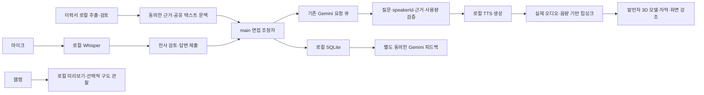

# 아키텍처와 제품 로드맵

## 현재 작업: 최종 3D 제품 설계 문서 수정

2026-10-22 KST 사용자 첨부 「최종 제품 재설계 및 실시간 3D AI 면접관 구현」을 목표 제품의 기준으로 삼는다. **현재 채팅의 명시 지시는 “코드 다 되돌리고 문서만 이대로 수정”이므로 이번에는 문서만 바꾼다.** 첨부의 “즉시 구현/Phase 1 시작” 문구는 후속 구현 요구사항이며 이번 코드 실행·의존성 설치·권한/CI 변경 승인이 아니다. 설계 PR 검토 전 구현·머지·자동화 큐 등록을 하지 않는다.

목표는 **한국인 스타일의 실사형 3D 면접관 두 명 + 기존 Gemini 텍스트 API + 무료 로컬 TTS/STT + 웹캠**을 사용하는 독립 실행형 Windows 앱이다. Electron·React·strict TypeScript·Vite·SQLite를 유지하고 별도 배포 backend/DB/추론 서버를 기본 구성에 추가하지 않는다. 외부 AI 비용은 사용자가 선택한 기존 Gemini에 한정하며 개발 중 유료 호출·개인 자료 전송은 별도 승인 없이는 하지 않는다.

요구사항·상태별 화면·참고 자료·AC는 [제품 스펙](specs/gemini-local-interview.md), 데이터/모델/실행·라이선스 경계는 [security](security.md#실사형-3d-제품-전환의-목표-보안-설계--미활성)가 소유한다. 이전 [MVP 1](specs/mvp-01.md)·[MVP 2](specs/mvp-02.md)는 당시 구현·승인·한도 기록으로 보존한다.

## 현재 구현과 재사용 — main f908ca4 기준

| 영역 | 현재 실제 구현 | 목표와 차이 |
| --- | --- | --- |
| 기반 | main·sandbox CJS preload·React renderer 분리, Windows portable, 한국어·테마·설정 dialog | 유지, 화면 정보 구조만 단계적으로 확장 |
| 이력서 | native dialog의 PDF/DOCX 한 개 제한 읽기 → sandbox worker 추출·근거·사용자 검토 | 재사용; 원문 전체 자동 전송·OCR 추가 아님 |
| 질문 | OpenAI·Claude·Gemini 고정 REST adapter, 질문/근거 id 검증·30초·취소 | Gemini 두 역할·speakerId·공유 문맥·사용량 미구현 |
| 기록 | node:sqlite schema 2, 12문항·100세션, 순서·중복·rollback·복원·삭제 | profile/speaker/usage/report용 보존형 migration 필요 |
| 음성 | OpenAI 전사·질문 MP3, 명시 동의·검토·수동 적용/제출 | 로컬 TTS/STT·오디오 기반 립싱크·대화 상태 전환 미구현 |
| 모델·장치 | 한시적 audio-only 마이크, 카메라 기본 거절 | 3D/GLB/glTF·실사 에셋·웹캠·MediaPipe 미구현 |
| 자격증명 | 선택한 키의 OS 보호 저장·테마/공급자별 모델 보존 | 면접관 모델/목소리·프로필 보존은 새 버전 계약 필요 |

3D 관련 실험 코드는 이번 문서 변경에 포함하지 않는다. 제품 코드·테스트·package/lockfile·workflow가 기존 기준과 같음을 별도로 확인한다. 과거 앱 테스트 수와 전체 자동화 테스트 수·실제 사용자 장치 검증을 합산하지 않는다.

## 목표 프로세스 경계

| 경계 | 유지할 책임 | 확장할 책임 |
| --- | --- | --- |
| src/main | 수명주기·정확한 창/프레임/URL IPC·고정 API·SQLite·OS 보호 키 | Gemini 턴 조정/프로필·허용 모델 선택/카탈로그·제한된 로컬 음성 실행·리포트 |
| src/preload | 기능별 window.studio API, 범용 invoke/shell/파일 접근 없음 | 모델·장치·음성·상태·취소의 좁은 계약 |
| src/renderer | 한국어 UI·문서 worker·메모리 녹음/재생·테마/접근성 | Three/R3F의 공유 3D 장면·애니메이션·립싱크·웹캠·로컬 분석 worker |
| src/shared | 순수 타입·한도·입력 검증 | speaker/profile·avatar capability·모델 manifest·상태·사용량/보고서 계약 |

GeminiQuestionProvider·InterviewOrchestrator·InterviewerProfileService·AvatarModelLoader·AvatarAnimationController·LipSyncController·LocalTTSProvider·LocalSTTProvider·CameraService·FaceAnalysisService·InterviewReportService·InterviewStore로 책임을 구분한다. 기존 클래스/호출부가 충분하면 재사용하며 선언만 있는 범용 프레임워크를 미리 만들지 않는다. 무거운 추론·decoder는 UI thread에서 분리한다.

production은 app://studio와 한정 번들 자산만 제공한다. renderer Node·외부 네트워크·탐색·webview 차단, sandbox/context isolation, 정확한 IPC 송신자 검사를 유지한다. 모델/텍스처/WASM을 위해 디렉터리 전체나 임의 URL을 공개하지 않는다.

## 모델과 완료 기준

**기본 모델 형식은 GLB / glTF 2.0이다. VRM은 필수가 아닌 후속 선택 호환이다.** Three.js·React Three Fiber·GLTFLoader·AnimationMixer·morph targets/blend shapes·Web Audio를 우선 검토한다. 구체 버전·peer·라이선스·Windows 호환성은 구현 착수 때 검증한다. 이번에는 설치/lockfile 변경이 없다.

렌더러/로더가 동작하는 것과 실사형 한국인 스타일의 성인 남성·여성 에셋을 확보한 것은 별도 완료 조건이다. geometry 인물은 개발/모델 부재/오류 대응용이다. 그것만으로 고품질 면접관 완료를 선언하지 않는다. 최종 외형은 허가된 사람 모델 두 개의 실제 로딩·피부/헤어·복장·리깅·표정·입 동작·성능을 검증해야 한다. 모델이 없으면 에셋 미확보를 명시하고 로더/교체 기반까지만 보고한다.

## 목표 데이터 흐름 — 아직 미구현

A/B는 같은 Gemini 키·공유 면접 기록·단일 요청 큐를 사용한다. 기본 교대, 필요한 꼬리질문은 같은 면접관 연속을 허용한다. speakerId가 모델·목소리·애니메이션·강조·자막을 함께 결정한다. 음성/영상 원본·얼굴 특징은 Gemini로 자동 보내지 않는다. 공유 문맥 확대와 평가 전송은 현재 한 구절/직전 답변 동의에서 자동 승계하지 않는다.

## 스펙 구현 순서 — 이번에는 계획만 갱신

| 단계 | 범위 | 완료 기준 |
| --- | --- | --- |
| Phase 1 | 실제 3D 면접관 두 명·GLB/glTF 로더/사용자 교체·대기/발언 애니메이션·강조/레이아웃 | Electron에서 실제 모델 두 개·발언 상태 전환·실행/교체 검증. 실사 에셋 품질은 별도 gate |
| Phase 2 | Gemini 두 역할·개별 personality·공유 문맥·질문/답변 턴·사용량 | 기존 이력서/기록을 유지하며 A 기술/B 경험 질문·speaker 검증·중복/취소·사용량 기록 |
| Phase 3 | 무료 한국어 로컬 TTS·개별 목소리·실제 음량 립싱크·질문 후 답변 상태 | 새 Gemini 질문을 추가 유료 API 없이 읽고 입과 오디오가 연동; 실패 시 텍스트 지속 |
| Phase 4 | 사용자 웹캠·장치/권한·질문/답변 화면 전환·해제 | 두 모델/웹캠 동시 표시, 거절/장치 제거/종료의 모든 track 정리 |
| Phase 5 | Whisper.cpp 로컬 전사·한국어/기술 용어·검토·답변·후속 질문·텍스트 대체 | 음성 답변을 로컬 전사하고 확인 후 Gemini 다음 질문, UI thread/기록 보호 |
| Phase 6 | MediaPipe 관찰·근거 리포트·커스터마이징 확장·끼어들기·성능/모델·음성 설치 관리 | 세부 항목을 작은 작업으로 분리·각 권한/에셋/전송/성능·삭제 AC 검증 |

성능/리소스 정리·관련 unit/Electron smoke·Windows source/packaged·실제 화면 기록은 각 Phase에서 수행한다. Phase 6까지 미루지 않는다. VAD/발화 종료 지원을 로컬 STT와 단계적으로 검증하되 자동 전송/제출은 별도 계약 전 활성화하지 않는다. 전이/취소가 명확한 턴 기반 음성 면접을 먼저 완성하고 끼어들기는 후속이다.

## 보존·설정·자동화

기존 이력서·질문/답변·키·기록을 삭제하거나 OpenAI/Claude 세션을 Gemini로 몰래 전환하지 않는다. 신규 기본 흐름은 Gemini+로컬 음성이지만 기존 adapter 제거는 호환성/복원·키 삭제와 별도 검토 후 결정한다. DB는 현재 평문이며 secure_delete/DELETE journal·profile ACL이 전체 암호화를 뜻하지 않는다. schema 1/2·요청 hash·미답변 순서를 보존하고 migration 실패는 rollback한다.

선택한 모델·voice·허용 personality·외형 capability 설정을 로컬에서 버전 관리한다. 지원하지 않는 외형/음성 설정은 비활성 이유를 표시한다. 기록·settings·3D 모델·음성 모델의 경로/수명을 분리하며 모델/장치 설정 복원은 권한·녹음·카메라·외부 전송 동의를 복원하지 않는다.

개발 자동화와 제품 완료는 분리한다. 기존 [#35](https://github.com/silverThunder09/ai-interview-studio/issues/35)·v1 ledger·승인 큐·리뷰 정책·CI 권한·브랜치 보호를 이 설계로 변경하지 않는다. [운영 관측](specs/gemini-local-interview.md#자동화와-검증-기록)을 참고하되 현재 상태는 실제 API로 확인한다. REA는 제품에 통합/번들하지 않고 별도 승인된 공개 UX 조사 도구로만 검토한다.
