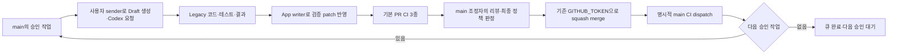

# PR 실행 승인 대기를 줄이는 인증 분리 설계

## 상태와 결정

**설계 초안·미구현·미활성.** 2026-10-25 KST 사용자의 「설계하자」 요청에 따른다. 이 문서의 작성이나 머지는 App 등록, 새 키/권한, workflow 변경 또는 운영 활성화 승인이 아니다. 현재 실행은 main의 [작업 목록](../.github/approved-loop.json), [머지 정책](../.github/review-policy.json), [운영 기록 #35](https://github.com/silverThunder09/ai-interview-studio/issues/35)를 따른다.

추천안은 **PR 작성자·Codex 요청은 기존 사용자 토큰으로 유지하고, 제품 브랜치 갱신·PR 메타데이터 변경만 저장소 전용 GitHub App으로 분리**하는 것이다. PR 생성/갱신에 대한 GitHub 기본 실행 승인 규칙을 해제하지 않고, 공식적으로 자동 CI를 발생시키는 인증 경로를 사용한다.

| 항목 | 현재 | 제안 |
| --- | --- | --- |
| PR 생성·작성자 | 기존 sender / `silverThunder09` | 그대로 유지 |
| Codex 요청 댓글 | 기존 sender / 사용자 계정 | 그대로 유지 |
| 제품 branch 생성·main 병합·patch 반영 | `GITHUB_TOKEN` | 별도 App 설치 토큰 |
| PR ready·본문 갱신 | `GITHUB_TOKEN` | 같은 App 설치 토큰 |
| ledger·조회·AI COMMENT 기록·조건부 squash merge | `GITHUB_TOKEN` | 그대로 유지 |
| PR CI | 기본 실행 + 별도 dispatch 검증 | 기본 PR CI 한 경로를 우선 사용 |
| merge 후 main CI | 명시적 dispatch | 그대로 유지 |

## 원인과 이미 승인된 범위

GitHub는 `GITHUB_TOKEN`의 PR `opened/synchronize/reopened` 이벤트로 생긴 기본 실행을 승인 대기로 만든다. 별도 App 설치 토큰 또는 PAT로 PR을 생성/갱신하면 이 기본 토큰 제약을 피하는 경로가 공식 지원된다. `workflow_dispatch`는 별도로 실행 가능하다. [공식 규칙](https://docs.github.com/en/actions/concepts/security/github_token#when-github_token-triggers-workflow-runs).

PR86 head `36e1351`에서는 기본 Validation/Windows/PR policy가 actor=`github-actions[bot]`, 같은 저장소·fork=false, `action_required`/job0이었다. 별도 dispatch 검증3개는 성공했지만 REST PR은 `unstable`이어서 strict `clean` 머지 조건이 거절했다. 기본 실행의 attempt2 성공 뒤 같은 코드가 `clean`으로 회복되고 기존 실행기로 머지됐다. 실행/로그 근거는 #35에 보존한다. 이는 모든 승인 대기의 원인이 항상 같다는 일반 규칙은 아니다.

기존 사용자 토큰은 댓글 전용으로만 쓰이는 것이 아니다. [loop-planner](../scripts/review/loop-planner.mjs)는 이미 승인된 계획의 `POST /pulls`를 sender로 수행하고 작성자가 `silverThunder09`인지 확인한다. [기존 사용 범위](event-loop.md)를 유지한다. 이번 설계에서 사용자 토큰의 Contents/Actions 권한을 늘리거나 새 용도로 확대하지 않는다.

App으로 PR까지 생성하면 작성자가 App 봇이 되어 현재 `allowed_authors=[silverThunder09]`와 충돌한다. 따라서 PR 생성은 기존 sender에 남긴다. App 봇을 허용 작성자에 추가하거나 작성자 검사를 생략하지 않는다.

## 인증과 API 호출 경계

| 담당 | 허용 호출 | 계속 금지할 호출 |
| --- | --- | --- |
| 기존 사용자 sender | 승인된 Draft PR 생성, 고정 Codex 요청 댓글 | commit/ref·PR 수정·merge·APPROVE·secret/설정 API |
| 새 App writer | 승인된 제품 branch의 blob/tree/commit/ref 생성·일반 main merge·patch ref 갱신, 같은 PR의 ready/본문 갱신 | PR 생성·main ref 갱신·force/delete·PR merge/APPROVE·workflow/secret/설정 API |
| 기존 main 조정자 | 현재 조회·ledger CAS·AI COMMENT·전체 검증 후 expected-head squash·고정 main CI dispatch | PR 코드를 특권 job에서 실행, 승인/보호 규칙 해제 |
| Legacy Codex·PR CI | 지정 SHA의 코드·합성 테스트·결과/patch 반환 | 세 인증정보 접근·GitHub 운영·실제 개인 자료·유료 모델 API 호출 |

`RuntimeAPI` 전체를 App 토큰으로 교체하지 않는다. API 호출 목적과 승인 task/branch/expected SHA를 받는 별도 writer 인터페이스를 주입한다. 같은 Git 객체 endpoint라도 ledger는 기존 조정자, 제품 branch의 객체는 App 경로임을 호출부에서 구분한다.

필수 전환 지점은 다음과 같다.

- `loop-planner.mjs`: seed 객체와 `work/<승인 task id>` ref 생성은 App, Draft `POST /pulls`는 기존 sender. 생성 응답의 실제 작성자·저장소·branch·SHA·본문을 검증한다.
- `synchronizedPR`: main을 제품 branch에 일반 merge하는 `POST /merges`도 App 경로다. base는 정확한 승인 branch, head는 재조회한 main SHA로 고정한다.
- patch 적용: 검증된 patch의 객체와 non-force ref 갱신은 App 경로다. 현재 parent와 허용 파일·mode를 확인한다. `main`·ledger branch·보호 파일은 writer에 넘기지 않는다.
- ready/본문: App으로 같은 PR node의 `markPullRequestReadyForReview`와 제한된 `PATCH /pulls/:n`을 수행한다. PR 작성자는 바뀌지 않으며 본문 검사가 새 이벤트로 실행된다.
- AI 검토 COMMENT와 squash merge는 기존 조정자 경로다. 두 writer나 sender가 사람의 APPROVE를 제출하지 않는다.

## GitHub App 설정 제안

사용자가 별도 승인 후 직접 등록·설치한다. 설치 대상은 이 저장소 하나, 설치 가능 계정은 소유 계정으로 제한한다. Webhook 수신은 끈다. 기존 Actions 이벤트가 조정자를 깨우므로 새 서버·웹훅 URL·시간 예약은 필요 없다.

| App 저장소 권한 | 범위·이유 |
| --- | --- |
| Contents: read/write | 승인된 제품 branch의 Git 객체·ref·일반 merge |
| Pull requests: read/write | 기존 PR의 ready·본문 갱신 |
| Metadata: read | 필수 저장소 식별 |
| Actions / Checks / Issues / Administration / Workflows / 조직·계정 권한 | 추가 요청하지 않음 |

App에는 보호 규칙 bypass를 주지 않는다. Contents 쓰기와 PR 쓰기는 GitHub 자체에서 branch나 특정 endpoint에만 한정되는 권한이 아니다. 토큰이 유출되면 wrapper보다 넓은 권한이 있으므로 이를 「main을 쓸 수 없는 토큰」이라고 표현하지 않는다. 기존 Ruleset/보호 규칙 상태를 설치 전 확인하고 유지하며, 미확인 상태를 보호 중이라고 가정하지 않는다. 추가 규칙 변경이 필요하면 별도 승인 대상이다.

제안 설정 이름은 공개 식별자인 Actions 변수 `AIS_PR_WRITER_APP_ID`, `AIS_PR_WRITER_INSTALLATION_ID`와 Actions Secret `AIS_PR_WRITER_PRIVATE_KEY`다. 기존 `AIS_CODEX_COMMENT_TOKEN`은 그대로 둔다. 지금은 어떤 변수/Secret도 생성하지 않는다.

실제 구현 시 저장소·작성자·승인 task/path를 확인한 뒤 필요한 writer 단계에서만 신뢰하는 main의 고정 Node 코드로 유효시간10분 이하의 App JWT를 만들고, 설치 토큰을 **이 저장소 ID 하나와 위 권한으로 축소**해 발급한다. 설치 대상 전체에 대한 기본 범위로 발급하지 않는다. 토큰은 보통1시간 만료이며 job 안에서만 사용하고 정상/실패 종료 시 폐기한다. 개인키·JWT·토큰은 마스킹하며 로그·캐시·artifact·Git·PR·Legacy·모델 입력으로 내보내지 않는다. PR checkout이나 npm/PR 스크립트를 토큰 보유 job에서 실행하지 않는다. 외부 토큰 발급 서비스나 새 npm 의존성을 전제로 하지 않는다. [토큰의 저장소/권한 축소와 만료](https://docs.github.com/en/apps/creating-github-apps/authenticating-with-a-github-app/generating-an-installation-access-token-for-a-github-app).

App 키/설치/권한 검증 실패 시 App 모드를 보류하고 #35에 비민감 오류를 기록한다. 실패했다고 자동으로 기본 토큰으로 제품 branch를 갱신하거나 사용자 sender를 branch writer로 전환하지 않는다. 기존 sender의 만료·사용 한도도 사라지지 않으며, 현재 사용자 관리 원칙을 유지한다.

## 이벤트·CI와 재개

1. App 모드의 PR은 기본 `Validation`/`Windows build`/`PR policy`가 주 검증 경로다. 같은 head/base/merge tuple에 현재처럼 별도 PR `loop-validation`도 항상 dispatch해 Windows 검사를 두 번 실행하지 않는다. ref 갱신 직후의 REST 등록 지연은 job 안의 짧은 제한 조회 후 기다리고, 뒤늦은 완료 이벤트에서 이어간다. 다음 유효 이벤트에서도 기본 실행이 끝내 없거나 다시 `action_required`라면 인증/이벤트 경로 이상을 기록하며 성공한 다른 경로로 덮지 않는다. 새 이벤트가 없으면 성공/자동 복구를 주장하지 않고 운영자가 한 번 재조회할 수 있다. 시간 예약·무한 polling·등록 지연만으로 새 Cloud 요청을 만들지 않는다.
2. `approved-loop.yml`의 `workflow_run` 재개를 위3개 **정확한 이름과 path**로 확장한다. 이름만 믿지 않고 같은 repository/head repository·허용 event·최신 task SHA·최신 attempt를 재조회한다. `workflow_run` job은 신뢰하는 main만 실행하고 후보 코드를 checkout하지 않는다.
3. 본문 갱신이 새 PR policy를 시작하면 merge 단계에서 기다린다. 최신 `checks/package/pr-policy` 모두 GitHub Actions 출처로 성공하고, 성공 `Record tested head and base` 명령 stdout의 **마지막 유효** `AIS_CI_EVIDENCE`가 현재 repo/PR/run/head/base/checkout 및 실제 merge 부모와 일치해야 한다. PR_BODY echo나 댓글 문자열은 증거가 아니다.
4. 매 판정에 모든 페이지의 원본 REST reviews·라벨·스레드·열린 review/bug 이슈를 전달한다. `countChangeRequests` 및 부정 테스트를 그대로 사용하며 COMMENTED/PENDING/DISMISSED로 다른 변경 요청을 지우지 않는다. strict `clean`, 미해결 finding0, exact-head AI COMMENT, expected-head squash와 실제 merged 재확인은 유지한다.
5. merge는 기존 `GITHUB_TOKEN`으로 남기므로 main의 보통 push CI가 자동 발생한다고 가정하지 않는다. 기존 명시적 main dispatch와 완료 확인 경로를 유지한다. main 성공 전에 다음 작업을 요청하지 않는다.
6. CI pending 또는 확인된 GitHub 실행 승인 대기는 `ci`/`merge` 단계의 명시적 기다림(`waiting_for`)으로 기록하고 새 개발/리뷰 요청 없이 해당 완료 이벤트에서 같은 정책을 재평가한다. 승인을 대신 누르는 endpoint는 추가하지 않는다. 일반 `paused`, 수동 중지, 차단 라벨, 사람의 변경 요청, 원인 불명·3회 상한 보류를 자동 해제하지 않는다. 기존 `paused/merge_policy_denied` 기록은 활성화 때 자동 초기화하지 않고 별도 검증된 인수인계로 처리한다.

## 중복 방지·오류·롤백

- 기존 lease·동시 실행 제한·outbox·CAS를 유지한다. 쓰기 의도를 먼저 저장하고 API 응답이 유실되면 모든 페이지의 실제 PR/댓글/ref에서 유일한 결과만 복구한다. 실패 조회를 「없음」으로 취급하거나 POST/새 Cloud 요청을 반복하지 않는다.
- 검증한 main/PR SHA·부모·spec hash가 바뀌면 현재 증거로 진행하지 않는다. force-push·임의 main 쓰기·보호 파일 자동 승인은 없다.
- App401/403·잘못된 설치 저장소·실행 승인 재발·불명확한 응답은 하나의 #35 기록으로 보류한다. 토큰 갱신은 명확한 만료에 한해 읽기 단계에서 제한하고, 결과가 모호한 쓰기를 자동 재전송하지 않는다.
- 활성 모드에만 App 설정을 요구한다. 기본은 기존 모드이며 Secret 존재만으로 활성화하지 않는다. 전환 변수 등 실제 구현은 별도 PR로 검증한다.
- 롤백은 먼저 #35의 기존 중지 경계로 새 작업을 멈추고 실행/lease 종료를 확인한 뒤 진행한다. 진행 중 writer의 인증을 중간에 바꾸지 않는다. 명시적으로 기존 모드로 돌아가면 기존 수동 실행 승인 경계도 돌아온다는 점을 기록한다. ledger·completed receipt·회차·실패 이력·기존 PR/실행은 삭제/reset하지 않는다.
- 이미 `action_required`인 과거 실행은 토큰을 바꿨다는 이유로 성공 처리하지 않는다. 필요한 기존 승인을 완료하거나 다음 정상 코드 변경의 새 CI로 검증한다. 빈 커밋·무의미한 PR·실행 삭제/취소를 승인 대기 제거 수단으로 쓰지 않는다.

## 구현·검증·운영 인수

구현은 (1) 역할별 writer/토큰 수명주기·부정 테스트, (2) main workflow의 App 설정과 호출부 전환, (3) 기본 CI 이벤트 재개·중복 PR dispatch 제거·기다림 처리, (4) 사용자 등록/명시적 활성화와 제한된 운영 검증 순서로 나눈다. 각각 검토 가능한 작은 PR로 만들고 실제 권한 범위를 설명한다. 문서만으로 운영 API나 큐를 바꾸지 않는다.

| 확인할 조건 | 합성/부정 검사와 실제 인수 기준 |
| --- | --- |
| 작성자 유지 | PR 생성은 기존 sender만 호출하고 실제 작성자가 silverThunder09가 아니면 보류; App 생성/PAT branch 쓰기는 거절 |
| 호출 역할 | App branch/ref/일반 merge/ready/본문, 기존 control ledger/COMMENT/squash/main dispatch를 각각 검증; 잘못된 토큰 역할 호출은 API 전 거절 |
| 범위 | 다른 repo·fork·main/ledger ref·보호 path·force/delete·APPROVE·설정 API를 거절; 허용 branch라도 expected parent 변경 시 보류 |
| 자격증명 | 설치 repo/permissions 축소, 만료·권한 누락·로그 마스킹·실패 시 fallback0; mock 성공은 실제 설치 성공으로 보고하지 않음 |
| CI 계기 | 각 기본 CI 완료가 정확한 main 코드를 깨움; 다른 path/name/repo/head/attempt 이벤트는 거절하고 이벤트 본문을 승인 증거로 쓰지 않음 |
| 기다림/재개 | CI/실행 승인 완료 후 같은 코드의 merge만 재평가; 명시 paused/사람 요청/차단 라벨/상한은 유지, 추가 모델 요청0 |
| 실제 증거 | 성공 step stdout과 실제 merge 부모, 모든 원본 review 페이지·change_requests·라벨/스레드/이슈 누락 부정 조건 유지 |
| 중복/경합 | 객체/ref/PR 응답 유실·lease 충돌·같은 이벤트 재실행 시 추가 PR/댓글/Cloud 요청0; head당 기본 Windows 검증 한 경로 |
| 정상 A→B | 별도 승인된 실제 작업2건에서 App actor의 PR CI가 승인 대기 없이 시작하고, CI/리뷰/머지/main 성공 후 다음 작업이 사람의 채팅 재지시 없이 시작됨 |
| 유지할 제한 | 실제 사용자 장치·유료 Gemini 호출·개인 자료·공개 release는 이 인수에 포함하지 않음 |

사용자는 구현/새 App·키·설치 권한·활성화 범위를 승인한 뒤 App을 이 저장소에만 설치하고 식별자2개·개인키1개를 GitHub 설정에 직접 등록한다. **키는 채팅으로 보내지 않는다.** 기존 기본 CI·sandbox·보호 규칙을 유지한 구현 PR 검증 후에만 활성화한다. 현재 큐에 없는 검증용 새 기능/PR은 이 문서로 승인되지 않는다. 적절한 승인 작업이 없으면 설치 확인까지만 하고 무인 A→B 실증은 미완료로 둔다.

App 전환 후에도 사람의 실제 변경 요청, 보호 영역 변경, 충돌, 서비스 장애·만료·사용 한도에서는 멈출 수 있다. 성공 기준은 승인 버튼이 사라졌다는 표시만이 아니라 **지정된 작업2건의 실제 결과→현재 CI/리뷰→머지→main→다음 요청과 중복0 증거**다. #35는 그 증거와 승인 경계를 확인한 뒤에만 종료한다.
