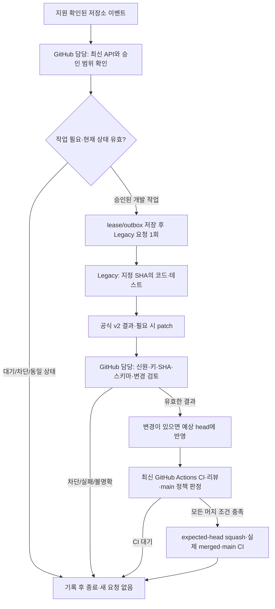

# GitHub 담당과 Legacy 개발 담당의 역할 분리

## 상태와 승인 범위

**역할 분리 경계의 구현을 진행 중이며 무인 운영은 활성화하지 않았다.** 2026-10-20 KST 사용자는 현재 채팅에서 「기존 연결로 역할 분리 설계: GitHub API·CI·머지 담당과 Legacy 코드·테스트 담당을 분리하고 이벤트/종료 전달 방안을 설계 PR로 제시」를 선택했다. 작성·검증·Draft PR 제출 뒤 같은 채팅에서 「문서만 검증 후 머지 승인」으로 PR #53의 문서2개 머지를 별도로 승인했다. 당시 승인은 문서에 한정됐다. 이후 같은 채팅의 「구현 실행안해? 그럼?」 요청으로 선택한 역할 분리의 구현에 착수했다. 새 인증 등록·권한 확대·기존 v1 종료 검사 완화·이벤트 활성화는 이 구현 요청에 포함하지 않는다. CI 성공을 미승인 운영 전환의 근거로 삼지 않는다.

현재 운영 기준은 [event-loop.md](event-loop.md), [review-automation.md](review-automation.md), main의 [review-policy.json](../.github/review-policy.json)이다. 이 초안은 기존 정책을 덮어쓰지 않는다. 구현·활성 여부는 [#35](https://github.com/silverThunder09/ai-interview-studio/issues/35)의 실제 증거로 확인한다.

## 문제와 확인된 근거

- [PR #52의 자동 요청](https://github.com/silverThunder09/ai-interview-studio/pull/52#issuecomment-6282588964)으로 [실제 Legacy 작업](https://chatgpt.com/s/cd_6ad6dec21fbc8191a752b08a60debab6)이 생성됐다. 같은 전달 job의 재실행은 추가 요청0을 기록했다.
- 사용자가 전달한 그 작업의 후속 보고는 GitHub REST 조회 HTTP404·gh 미인증, npm run check 종료 코드0·단위314·정책40·타입/린트 성공이다. 이는 당시 PR52 head의 검사이며 현재 main 전체의 새 검사로 재사용하지 않는다.
- [공식 최종 응답](https://github.com/silverThunder09/ai-interview-studio/pull/52#issuecomment-6282607338)은 paused 문구에 View task 링크가 붙었다. 기존 실행기는 전체 본문이 독립 종료 marker일 때만 인정하므로 이를 종료로 받지 않았다. 정상 개발 완료·후속 재개는 미검증이다.
- 이 채팅의 연결된 GitHub 도구는 같은 비공개 저장소의 API 조회·브랜치/커밋/PR 작성에 성공했다. 이것은 별도 Legacy 컨테이너의 CLI 인증 증거가 아니다.

## 승인자가 판단할 핵심

| 항목 | 제안 | 유지할 경계 |
| --- | --- | --- |
| GitHub 담당 | 연결된 GitHub 도구가 있는 실행 환경에서 최신 상태·코드 반영·CI·머지를 처리 | 해당 저장소·허용 작성자·main 대상·승인된 작업만 처리 |
| Legacy 담당 | 지정 SHA에서 코드 검토/수정·로컬 검사를 하고 결과를 반환 | GitHub API·토큰·머지·승인 판정을 요구하지 않음 |
| 결과 전달 | 공식 개발 작업의 제한된 v2 보고서를 새 계약으로 검증 | 기존 v1의 전체 본문 검사를 느슨하게 바꾸거나 과거 요청을 대신 완료하지 않음 |
| 수정 내용 전달 | 플랫폼이 전달한 제한된 patch를 GitHub 담당이 검토한 후 예상 head에 반영 | 응답 텍스트를 명령으로 실행하지 않으며 보호 경로는 새 승인 없이 거절 |
| 다음 작업 | 검증된 이벤트가 GitHub 담당을 깨우고 현재 상태를 재조회 | 시간 예약·변경 없는 무한 polling·동시 중복 발신 금지 |

**현재 도구만으로 새 webhook 등록까지 완료할 수 있다는 근거는 없다.** 이벤트 수신과 결과 전달을 실측하기 전에는 무인 루프를 활성화하지 않는다. 새 PAT·모델 API 키·외부 서버·유료 서비스·공개 release·제품 자료 전송을 전제로 하지 않는다. 기존 Codex/Actions 사용 한도가 사라지는 것도 아니다.

## 담당과 권한

| 담당 | 수행 | 수행하지 않음 |
| --- | --- | --- |
| GitHub 담당(조정자) | main 지침·승인 범위 확인, 모든 페이지의 PR/reviews/라벨/스레드/관련 이슈·CI 로그 조회, 변경 검토·조건부 commit/push, 정확한 head의 AI COMMENT, main 판정기·expected-head squash·main CI 확인 | self APPROVE, 사람의 요청 해제, 정책 자동 완화, Legacy에 인증정보 전달 |
| Legacy 개발 담당 | 지정 checkout 확인, main 지침에 따른 승인 범위의 코드 검토/수정, 영향 검사, 비민감 결과와 필요 시 patch 생성 | gh 로그인·REST 조회/댓글 쓰기, 직접 push/머지, 최신 원격 상태·API 권한·머지 성공의 추정 |
| 이벤트/전달 계층 | 지원되는 wake-up 전달, 원자적 lease/outbox·receipt·중복 방지 | 이벤트·상태 보고를 코드 승인이나 CI 성공으로 승격 |
| 사용자 | 설계/구현/활성 단계 승인, 새 범위·불명확한 고위험 결정 | 토큰을 채팅에 전달하거나 개인 PC에서 개발·디버깅할 필요 없음 |

GitHub 담당은 매 실행에 연결된 도구로 실제 읽기 가능 여부를 확인한다. 기존 연결에 API가 없거나 실제 요청이 거절되면 보류하며 다른 계정·저장소로 바꾸지 않는다. 새 GitHub App 권한·PAT·Actions Secret 용도 확대는 이 설계에 포함하지 않는다. 현재 발신 전용 AIS_CODEX_COMMENT_TOKEN을 Legacy 환경변수·파일·요청·로그에 복사하지 않는다.

## 제안 흐름



그림의 이벤트 등록·상시 실행·자동 patch 원격 반영은 아직 활성화/실측되지 않았다. v2 요청 생성·결과 검증·patch 반영 계획은 아래 CLI로 구현했으며, 실제 플랫폼 대조는 별도로 기록한다. v2 결과는 GitHub 담당을 깨우는 데이터이며, 실제 머지 검사는 기존 [review-automation.md](review-automation.md)를 따른다.

## 이벤트 등록과 현재 도구의 한계

공식 Work 문서는 연결된 GitHub 저장소의 지원되는 PR 활동으로 이벤트 작업을 만들 수 있다고 안내한다. 실제 제공 이벤트·필터는 등록 환경의 지원 스키마로 확인해야 한다. 현재 이 채팅 도구에는 discover_webhook_schema와 triggers 입력이 없어 등록하지 않았다. 문서의 기능 설명을 이 계정의 등록 성공으로 간주하지 않는다.

1. 구현 승인 후 실제 등록 경로에서 저장소 하나·허용 작성자·main 대상 조건을 확인한다. 지원하지 않는 세부 필터는 wake-up 후 API로 다시 검사하되 저장소 범위는 넓히지 않는다.
2. PR 변경, 필요한 CI 완료, 공식 개발 결과 수신이 각각 조정자를 깨울 수 있는지 실측한다. workflow_run·check_run·댓글 이벤트를 지원한다고 추측하지 않는다. 일부만 지원되면 누락 경로는 차단 상태로 남긴다.
3. 기존 Actions receiver가 CI 완료를 받아도 그것만으로 연결된 GitHub 도구가 있는 조정자가 실행되는 것은 아니다. 둘 사이의 지원되는 전달 경로와 실제 실행 ID가 필요하다. 숨겨진 Cloud API·쿠키·새 webhook 서버·시간 예약으로 메우지 않는다.
4. 등록 전에는 기존 채팅에서 사용자가 시작한 한 번의 조정만 가능하다. 이를 자동 후속 실행으로 보고하지 않는다. 등록 완료 후에도 변경 없음·CI 진행 중에는 조용히 종료하고 실제 변경·실패·결정 필요만 알린다.

## 요청·결과 계약 v2 제안

### 요청

GitHub 담당이 repo/PR·승인된 작업 범위·예상 head/base·64자 request_key·schema=2를 고정해 요청한다. PR 본문이 작성한 허용 경로나 승인을 신뢰하지 않는다. Legacy는 체크아웃 SHA가 다르거나 필요한 main 지침을 읽을 수 없으면 blocked를 반환한다. API 조회 실패를 숨기기 위해 새 인증을 찾지 않는다.

### 결과 보고서 예시 — 현재 실행기 입력이 아님

```json
{
  "schema": 2,
  "kind": "development-result",
  "repository": "silverThunder09/ai-interview-studio",
  "pr_number": 52,
  "request_key": "6981e09318ce47238560263a2c9da149040cddc4485acc5555e55707cebaa1ac",
  "checkout_sha": "448937e3baa94481f26add807732831efa340cd6",
  "requested_base_sha": "f4203238f5ffa382f0b7dfebe0015608ff2020ad",
  "outcome": "blocked",
  "tests": [{"command": "npm run check", "exit_code": 0, "unit_passed": 314, "policy_passed": 40}],
  "change": {"kind": "none"},
  "blocker": {"code": "github_api_unavailable", "summary": "API 처리는 인증된 GitHub 담당에게 인계 필요"}
}
```

이 값은 PR52 당시 사례의 **계약 예시**이며 현재 성공 증거나 v2 실행 결과가 아니다. requested_base_sha는 요청 시 기준일 뿐 최신 원격 main의 관측값이 아니다. 최신 main은 GitHub 담당이 별도로 조회한다. Legacy가 실제로 실행하지 않은 검사에는 통과 수를 만들지 않으며 결과가 없으면 명시적으로 미검증을 반환한다.

### 수신 검증과 종료 구분

- 현재 v1의 독립 전체 본문 검사와 과거 ledger는 그대로 둔다. 링크를 제거해 v1 marker를 받아들이거나 GitHub 담당이 원래 Cloud 종료 댓글을 대신 작성하지 않는다.
- 새 v2는 **공식 개발 결과 전용 형식**으로 분리한다. 허용 공식 bot의 login/type·같은 저장소/PR·기존 outbox key·예상 checkout·요청 이후 댓글·유일한 결과를 함께 확인한다. 일반 리뷰 summary/receipt·다른 nonce·작성자 사칭·과거 응답은 거절한다.
- JSON은 단일 객체, 중복 키·알 수 없는 필드·타입 오류·허용하지 않은 상태를 거절한다. 플랫폼이 덧붙이는 View task 링크는 실제 관측된 고정 envelope를 별도 스키마로 다룬다. 허용된 host/path의 작업 링크1개 외 임의 prefix/suffix·다른 URL·둘 이상의 객체는 거절한다. 실제 플랫폼 출력으로 형식을 검증하기 전에는 수신기를 활성화하지 않는다.
- 로컬 결과 상태는 succeeded/failed/blocked로 한정하고 blocked/failed에는 비민감 이유를 필수로 둔다. 상태만 남겨 사람이 보류 이유를 알 수 없는 문제를 반복하지 않는다. GitHub 담당의 CI 대기·검증 완료·머지 상태는 별도로 관리한다.
- 공식 최종 개발 보고서의 수신과 과거 API의 terminal 상태 관측을 혼동하지 않는다. v2에서 어떤 플랫폼 응답을 개발 단계의 종료 receipt로 삼을지 구현 PR이 명시해야 한다. 이를 확정·승인·실측하기 전에는 새 head의 다음 개발 요청을 열지 않는다.
- 코드 검토 결과·exit_code0·task 링크는 머지 승인이나 GitHub Actions의 AIS_CI_EVIDENCE가 아니다. GitHub 담당은 최신 원본 reviews 모든 페이지와 countChangeRequests, 라벨·스레드·연결 finding, 최신 CI 실제 stdout을 독립 확인한다. main의 policy.mjs·보호 파일 승인·예상 head squash 조건을 유지한다.

## 수정 내용의 전달과 반영

읽기 전용 검사는 change.kind=none으로 끝나며 불필요한 커밋을 만들지 않는다. 코드 변경이 있으면 공식 플랫폼이 제공하는 diff를 지원 도구로 읽거나, 개발 결과에 포함된 제한된 UTF-8 patch를 전달하는 방안을 구현 PR에서 검증한다. 현재 도구에 Legacy 내부 diff 읽기 기능이 없다는 한계를 숨기지 않는다. 플랫폼의 실제 전달이 안 되면 patch_unavailable로 보류하고 빈 커밋·사용자 PC 작업으로 대체하지 않는다.

초기 patch 제안 한도는 64KiB·10파일이다. 실제 프로토타입 후 필요한 조정도 별도 검토한다. 원문은 해당 비공개 저장소/작업 범위에서만 다루고 채팅·전체 CI 로그에 출력하지 않는다. GitHub 담당은 다음을 모두 확인해야 한다.

1. 예상 PR head·main 재조회, 승인된 변경 경로와 전체 diff 확인. 오래된 head/base, 보호 경로·이전 rename 경로, 범위 확대, 실제 개인정보/secret 의심 변경은 거절한다.
2. 바이너리·symlink·파일 모드 변경·rename/delete·경로 탈출·크기 초과·다중/불명확 결과는 첫 구현에서 거절한다. patch/명령/검사 문자열을 shell·eval로 실행하지 않는다.
3. 격리된 작업 트리에서 데이터 파일로 읽어 적용 가능성을 확인하고 코드·호출부를 검토한다. 임의 응답을 특권 Actions job에서 실행하거나 그 job에 PR 코드·artifact를 checkout하지 않는다.
4. 기존 파일/tree·현재 parent와 예상 branch head를 보존한 작은 commit을 작성한다. Git이 막히면 연결된 tree/commit/ref API의 force=false·expected SHA를 사용한다. 실패 시 다시 읽고 우회하지 않는다.
5. 새 원격 head의 GitHub CI를 확인한다. Legacy가 이전 checkout에서 실행한 검사를 새 commit의 CI 증거로 바꾸지 않는다. AI COMMENT는 정확한 head/base에 남기고 독립 사람 승인으로 표현하지 않는다.

## 단일 담당·상태·전환

현재 worker와 새 조정자가 동시에 같은 PR을 발신하지 않도록 해야 한다. 구현 PR은 동일 저장소의 CAS/lease와 담당 epoch를 명시하고 **한 담당만 발신**하도록 한다. 기존 worker가 v2를 이해한다고 가정하지 않는다. 실행기 전환은 별도 승인 후 원자적으로 수행하며, 전환 실패 시 새 발신을 중단한다.

제안 상태는 prepared → sending → dispatched → result_reported → result_validated이며, 그 뒤 조정자의 CI 대기/검증 완료/blocked를 구분한다. 단순 보고 수신으로 다음 개발 요청을 허용하지 않는다. 동일 key는 재전송하지 않고 다음 유효 head/CI 이벤트도 이전 단계 종료 확인 후1회만 처리한다. 현재 PR 수·수정 횟수·전체 dispatch 한도·lease·보류/중복 이슈 규칙은 낮추지 않는다.

PR48/50/52와 기존 v1 outbox는 보존한다. 과거 결과를 새 v2 요청에 연결하거나 수동 전달을 원래 outbox의 완료로 승격하지 않는다. ledger schema·이관·기존 보류 재개는 별도 승인된 계획과 백업/검증이 필요하다. 되돌릴 때도 새 발신만 먼저 멈추고 진행 중 결과·실패·lease 이력을 보존한다. 토큰 자동 복사/삭제·ledger reset·force-push는 하지 않는다.

## 구현 순서와 인수 기준 — 단계별 실제 증거 필요

| 단계 | 구현 전에 확인할 것 | 통과 증거 |
| --- | --- | --- |
| 1. 설계 결정 | 역할·이벤트 지원 경로·v2 envelope·patch 전달·기존 요청 처리 | 사용자 설계/문서 머지 승인, 이후 구현 범위 별도 승인 |
| 2. 전달 프로토타입 | 무자격증명 Legacy의 결과/patch → 인증된 담당 수신 | 같은 저장소의 합성 작업, 실제 원래 key·checkout·공식 bot·task 링크·비민감 이유/patch 일치 |
| 3. 실패 경계 | 다른 키/PR/SHA/작성자, 코드 리뷰, marker 예시, JSON 중복 키·초과 크기·임의 링크·patch 탈출 | parser·신뢰 경계 부정 테스트, blocked는 다음 요청0 |
| 4. 원격 반영 | patch 승인 범위·예상 parent 보존·경합·응답 유실 | 작은 합성 변경1개·동일 상태 추가 commit/요청0·새 head CI |
| 5. 이벤트 재개 | 실제 등록된 PR/CI/결과 이벤트, lease 경쟁·중복 | 같은 이벤트 추가0·다음 유효 이벤트1·겹친 개발 작업0·실제 실행 ID |
| 6. 머지/회귀 | 원본 reviews 전 페이지·사람 변경 요청·라벨·최신 실제 CI 증거·예상 SHA | 기존 main 판정기 허용·실제 merged·현재 main CI 성공, 회귀 시 기존 이슈/fix PR |

현재 기능으로 단계2의 공식 결과/patch 전달 또는 단계5의 필요한 이벤트를 지원하지 못하면 그 단계에서 보류한다. 문서·합성 테스트·시간 경과만으로 #35를 닫지 않는다. 성공 기록은 [테스트 기록 절차](testing/README.md)에 따라 당시 SHA/원본 실행 링크와 미검증 항목을 구분해 남긴다.

## 구현된 v2 경계와 실행 방법

`scripts/review/connected-controller.ts`는 Node 24.19의 순수 로컬 CLI다. 연결된 GitHub 담당이 이번 실행에서 조회한 API 데이터를 JSON 파일로 제공하고, 출력 파일을 검토한 후 지원되는 GitHub 도구를 호출한다. CLI 자체는 네트워크·자격증명·ledger·branch·merge를 변경하지 않는다.

```sh
node --experimental-strip-types scripts/review/connected-controller.ts request request-input.json request-comment.txt
node --experimental-strip-types scripts/review/connected-controller.ts plan result-input.json result-plan.json
```

입력 파일은 비공개 작업 공간에 두고 전체 본문을 로그에 출력하지 않는다. 출력은 새 파일에만 기록하며 기존 파일을 덮어쓰지 않는다. 표준 출력에는 동작·네트워크 호출0·머지 권한 false 요약만 남긴다. 실패는 종료1과 고정 오류 코드다.

- `request` 입력은 `{request}`이며 schema2·고정 repo/PR·64자리 key·40자리 head/base·UTC requested_at·mode·allowed_paths를 요구한다. 읽기 전용 경로는 빈 배열이다. repair는 명시적으로 승인된 비보호 기존 텍스트 경로10개 이내다.
- `plan` 입력은 `{request,snapshot}`이다. snapshot은 source=`connected-github-current-run`, 이번 main SHA, 원본 PR, **모든 페이지**의 labels/comments 및 completeness 표시, 영속 저장소에서 읽은 processed_receipt_ids를 포함한다. 누락·오래된 SHA·차단 라벨·다른 저장소/작성자·모호한 응답을 거절한다. completeness/source 문자열은 인증 증명이 아니므로 PR/댓글이 제공한 값을 복사하지 않는다.
- 공식 bot의 새 v2 보고서 전체와 고정 View task envelope를 별도로 검증한다. 기존 v1 종료 marker와 호환시키지 않는다. 로컬 check 성공 보고도 원격 CI/머지 증거로 쓰지 않는다.
- repair 계획에는 정확한 head에서 읽은 `contents_head_sha`, `base_tree_sha`, `contents[path]={content,mode,blob_sha}`가 추가로 필요하다. 100644 일반 파일·Git blob hash·patch 문맥·위치를 확인하며 symlink/바이너리/보호 경로·변조/오래된 본문을 거절한다.
- 출력은 wait/blocked/review/commit이다. commit에도 merge_authorized=false이며 예상 parent/head·base tree·force=false와 검토할 파일 데이터만 들어간다. 연결 담당은 재조회·코드 검토 후 tree/commit/ref API를 호출하고 새 SHA의 CI와 기존 main 판정기를 따로 확인해야 한다.

**완료되지 않은 부분:** 이 CLI는 영속 상태 저장·자동 원격 반영·다음 작업 wake-up을 직접 수행하지 않는다. 별도 저장 모듈의 구현 범위는 아래와 같으며 실제 worker/이벤트에 연결하지 않았다. processed_receipt_ids를 빈 배열로 반복 실행하는 것은 중복 방지 구현이 아니다. 기존 v1 worker와 함께 새 자동 발신기를 켜지 않는다. 현재 실행에서 시작한 제한된 검증 결과를 전체 무인 루프 성공으로 보고하지 않으며, 이 항목들의 실제 검증 전 #35는 열린 상태로 유지한다.

## 실제 전달 검증 기록

- [PR #54 공식 결과](https://github.com/silverThunder09/ai-interview-studio/pull/54#issuecomment-6286612982)는 지정 checkout의 단위384·정책40 성공을 보고했다. 연결 담당의 전체 envelope/key/head/base 검증은 review/merge_authorized=false였고 기록한 receipt의 재처리는 already_processed로 거절했다.
- [PR #55 첫 patch 응답](https://github.com/silverThunder09/ai-interview-studio/pull/55#issuecomment-6286860357)의 알 수 없는 passed 합산 필드는 invalid_fields로 거절했으며 patch를 반영하지 않았다. 요청의 허용 검사 필드명을 명시하고 이 실패 경계를 회귀 테스트로 보존했다.
- 수정 head의 [공식 patch](https://github.com/silverThunder09/ai-interview-studio/pull/55#issuecomment-6286969728)는 단위404·정책40 성공과 테스트 파일1개의 변경을 반환했다. 전체 공식 envelope·원본 key/SHA·mode/blob hash/문맥을 확인한 결과 commit/merge_authorized=false였으며 연결 담당이 patch를 검토하고 로컬 영향 테스트19개를 확인했다. 실제 원격 반영·새 head CI/머지 증거는 [PR #55](https://github.com/silverThunder09/ai-interview-studio/pull/55)에서 확인한다. 이 제한된 수동 대조는 영속 v2 저장소의 실운영·이벤트 자동 재개 성공 증거가 아니다.

수신·반영 후 [PR #55 checks 실행](https://github.com/silverThunder09/ai-interview-studio/actions/runs/39396107792/job/118539131108)은 head e6186ab2d226a4ff8110db0bfab048cfa4fa6fd0의 단위404·정책40 및 native CLI 검사를 통과했다. 이 실행의 실제 checkout은 4b94c32cd943146574875ba01bd4dbdded96bdd1이다. ready 전환 후 GitHub가 병합 참조를 13683bc4d1774d583b412293c226c32c98bd1a8d로 다시 만들었으므로 이 과거 성공을 최종 머지 증거로 재사용하지 않는다. 최종 기록 반영 뒤 새 head/base/merge checkout과 일치하는 최신 검사를 별도로 요구한다.

## 비활성 v2 영속 저장 모듈

`scripts/review/development-journal.ts`는 연결된 GitHub 도구를 주입받는 저장 라이브러리다. 네트워크 클라이언트·token 조회·자동 실행 진입점은 없다. 고정 저장소의 `automation/development-v2` 브랜치와 `.automation/development-v2.json`만 사용하며, **이 브랜치/파일을 만들거나 기존 worker를 전환하지 않았다.** 저장 위치 초기화·운영 담당 전환·이벤트 활성화는 실제 지원과 후속 승인/검증이 필요하다.

- 명시적 epoch·유한 lease·request key/PR/head/base/요청 본문 SHA256을 보존한다. owner는 실행마다 새로 생성한 64자리 난수 식별자를 쓰고 여러 실행이 재사용하지 않는다. `prepared → sending → dispatched → reported`를 구분하며 sending 저장 성공 전에는 발신할 수 없다. sending 이후 응답 유실/lease 만료는 재발신 이유가 아니다. 실제 원래 댓글을 조회해 ID를 확인할 수 없으면 보류한다.
- 같은 요청/댓글/결과는 멱등 처리하고 다른 본문·SHA·영수증 ID 재사용은 거절한다. reported도 다음 요청을 허용하지 않는다. CI·머지까지 검증하는 종료/담당 전환 로직은 아직 연결되지 않았으며, 이 모듈에 임의 completed·활성화 필드는 없다.
- transport는 현재 ref/commit/file을 정확한 SHA로 읽고 기존 base tree와 parent를 보존해 작은 commit을 만든다. 저장 전 ref·tree·전체 상태·revision/epoch·불변 이력을 확인하고, ref 갱신에 expected SHA와 force=false를 전달한다. 경합·권한 거절·누락 파일은 오류로 반환하며 자동 초기화/reset/강제 쓰기/재시도를 하지 않는다. 멱등 저장도 현재 원격 상태를 확인한다.
- 실제 발신이 필요해지는 후속 구현은 full v2 parser로 공식 결과를 검증한 뒤 receipt만 기록해야 한다. 주입된 transport의 API 인증·본문 hash 일치·기존 v1 담당과의 단일 발신 보장 및 실제 원격 CAS를 실측해야 운영에 적용할 수 있다. 합성 transport 테스트는 GitHub 실제 경합이나 자동 후속 실행의 증거가 아니다.

## 참고

- [Work의 이벤트 기반 작업](https://help.openai.com/en/articles/20001275-chatgpt-work-and-codex): 지원되는 GitHub PR 활동·등록 환경과 권한의 기준. 현재 도구의 등록 성공을 보장하는 자료는 아니다.
- [GitHub와 Legacy 개발 작업](https://learn.chatgpt.com/docs/third-party/github): 일반 개발 요청과 코드 리뷰의 구분. Legacy 셸의 REST 인증을 자동 보장하지 않는다.
- [Legacy 환경](https://learn.chatgpt.com/docs/environments/cloud-environment): 실행 단계·환경변수/secret 경계. setup 전용 secret을 agent 단계에 남기는 우회는 설계에 포함하지 않는다.

승인 검토 시 핵심은 **문서 머지 여부**, 다음 구현에서 다룰 **v2 결과 계약·patch 전달·이벤트 경로**, 그 구현 이후의 **활성화/기존 요청 이관 여부**를 구분하는 것이다.
