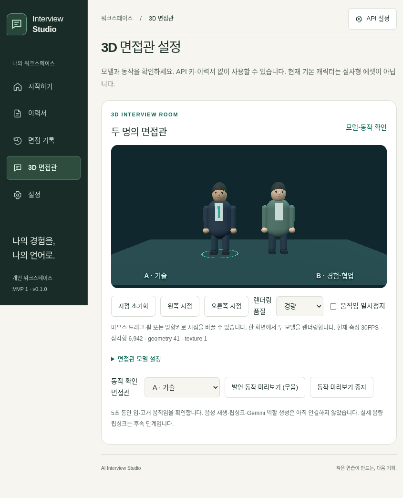

# Phase 1 3D 기반 — 실제 Electron 화면·모델 교체 검증

- 기록 ID: tests-2026-10-22-phase1-local
- 기준일: 2026-10-22 KST
- 대상: silverThunder09/ai-interview-studio, main 130fa63e9ba2a70ce42fd552958be577c8601ae2 기준.
- 초기 코드: ea62bfa9c077ad9744b36b8dc4c02df5abcc6bc5 / tree ce540137b0f3a660dd1431146745e123a15734d6.
- 프레임 보존·픽셀 검증 수정: 원격02dab4024b008c76c4429c8191c9e35f24379b9f, 로컬f938db3e9fa6eccf60587c1f2b6e45e9c488aaa5와 tree768b9905ac29116eab0e2b4b4492982863ad99ef 일치.
- 프레임 일정 보정 코드: 원격54e4c193111bc1ddff8c5215bbfb9769563f4060 / tree fd9ad82bc9f85eb4f6fb7013e77b1214e842d32d. 로컬 a1eb771과 코드 tree가 같다.
- 상태: 실제 3D 기반 검증 성공. 최종 제품 코드의 PR head1e255efa550954b01a134ba3ae1ed2f1882ca3eb에서515/41·Windows 원본10/패키지10·두 실행30FPS를 확인했다. 이후 기록만 갱신하며 정확한 CI 신원은 [최신 기록](latest.md)에 연결한다. 실사 에셋 품질 완료 아님.
- 차단 추적: [이슈 #73](https://github.com/silverThunder09/ai-interview-studio/issues/73).

## 성공한 검사

| 검사 | 실제 결과 | 한계 |
| --- | --- | --- |
| npm run check | TypeScript·ESLint, 단위515개(25파일)·정책41개 통과 | 실제 WebGL/사용자 GPU 품질을 증명하지 않음 |
| GLB/glTF 단위 검사 | 실제 GLTFLoader로 자체 합성 geometry/morph 로딩, 외부 fetch 0, 무음 morph 시작/중단과 geometry dispose 확인 | 렌더러/GPU는 구동하지 않음 |
| 내장 텍스처 | Blob bytes를 직접 bitmap decoder로 전달하는 계약·외부 fetch 0 확인 | 단위 검사는 decoder 대체. 실제 PNG decode/렌더는 smoke 대기 |
| 보안·보존 | URL/임의 파일/한도/순환/확장 거절, slot/token·준비/commit·복원·실패 보존·앱 사본 삭제 | 사용자 실제 모델/사용권 보증 아님 |
| npm run build | main/preload/React·지연 로딩 3D chunk 생성 성공 | 앱 실행 성공 아님 |
| npm run licenses | 실제 설치한 runtime/renderer 번들 의존성7개 원문 라이선스 수집 | 실사 모델은 동봉하지 않음 |
| 문서·diff | 영향 문서4개 상대 링크/앵커27개·diff 검사 통과, workflow/리뷰 도구 변경0 | 이후 이 기록/색인 링크는 별도 확인 |

전체 check의 기존 CLI 자식 프로세스 테스트는 최초 실행 도구 제한(spawnSync EPERM)으로 실패했다. 동일 소스/명령을 실행 권한 확인 후 다시 수행해 전체513/41 성공을 확인했고, 이후 프레임 일정 회귀2개를 추가해515/41을 통과했다. 이 추가 단계 전후의 개수를 합산하지 않는다.  테스트를 삭제하거나 sandbox 조건을 낮추지 않았다.

## 실제 화면과 프레임 보존 수정

모형 그림이 아니라 실제 Electron/WebGL 2.0 화면이다. 자체 geometry 캐릭터이며 실사형 모델이나 최종 아바타 디자인이 아니다. Linux Ozone headless + 명시적 ANGLE SwiftShader, sandbox/contextIsolation/CSP를 유지했다. 테스트 실행 옵션은 Windows 제품의 기본 그래픽 설정을 바꾸지 않는다.

기존 프레임 cap에서는 브라우저 drawing buffer 폐기 시점에 캡처가 빈 화면으로 나올 수 있었다. 실제 프레임 픽셀 색 수가447→1로 번갈아 관측됐으며 렌더 호출/삼각형 수만으로 성공을 판정하던 smoke로는 잡히지 않았다. 마지막 frame을 보존하고 기본 인물 A/B 영역의 실제 픽셀 다양성과 일시정지 뒤 장면 유지도 검증하도록 고쳤다. 수정 뒤 연속8프레임이442~447색을 유지하고 GL 오류0·context lost=false였다. 숨김/이탈 시 자원 해제는 유지한다.

로컬 실제 smoke는 모델 두 개·GLB/내장 PNG·glTF·눈/입 morph·무음 동작 시작/중단·잘못된 URL 거절·기존 사본 보존·재시작 복원·기본 모델 복귀·GPU context 해제를 성공 확인했다. 로컬 FPS는 이 조건에서 약30이며 사용자 Galaxy Book3 360의 보장 성능이 아니다. 초기 수집 후 다음 snapshot에서 CPU는 Browser 약1.16%·GPU 프로세스 약37.82%·Tab 약3.93%, working-set은 각각 약154/166/148MiB(Utility 약71MiB)였다. GPU 프로세스의 CPU 사용률은 GPU 사용률이 아니며 working-set은 VRAM이 아니다. 짧은 측정 구간의 값이고 지속 부하/peak·전용 VRAM/GPU 사용률은 미측정이다.

최초 Windows [run39737804211](https://github.com/silverThunder09/ai-interview-studio/actions/runs/39737804211/job/119687522592)은 heada1bcdbdc3e3e0b8198066828941460c34df5836b에서 단위513·정책41·원본10/패키지10을 성공했다. 소프트웨어 그래픽 상태에서 두 장면 측정은22FPS였다. 이 이전 성공을 픽셀 보강 후 최신 head의 CI 증거로 대신 사용하지 않는다. 로그의 process working-set은 VRAM이 아니고 CPU 첫 snapshot0은 지속 사용률/peak를 의미하지 않는다. 강화된 smoke는 수집을 먼저 시작하고 후속 snapshot을 남긴다.

## 실패 이력과 남은 검증

- 최초 기존 CLI 검사 실패(spawnSync EPERM)는 같은 소스/검사로 실행 도구 권한을 확인한 뒤 전체 통과했다.
- 일반 Linux GUI는 X 서버/$DISPLAY가 없어 시작하지 못했다. headless 자동 그래픽 선택과 테스트 data-engine 속성 충돌도 각각 구분해 해결했다. 이후 명시적인 소프트웨어 renderer를 선택해 실제 장면을 검증했다. sandbox나 검사 조건을 끄지 않았다.
- 원격 commit은 최초 문서-only 범위 심사로 거절됐지만 사용자의 명시 승인 뒤 같은 API가 성공했다. 우회하지 않았으며 진행/검증은 #73·PR #74에서 추적한다.
- 사용자 노트북의 실제 GPU/VRAM·CPU/메모리 peak·지속 부하, 실사형 한국인 스타일 남성/여성 에셋과 배포 라이선스는 미검증/미확보다. 기본 geometry를 실사 품질 완료로 표시하지 않는다.
- 외부 파일 묶음 glTF·압축 확장·모델 다운로드, 실제 TTS 립싱크·Gemini 두 역할·웹캠·STT·리포트는 이번 기반에 포함하지 않는다.

최종 최신 head의 checks/package/pr-policy·Windows 픽셀 smoke·원본 리뷰/라벨/스레드·CI stdout 증거와 main 판정을 확인한 뒤에만 머지한다. 과거 앱 기준/아카이브는 보존하며 기반 PR 머지와 Phase 1 전체/실사 품질 완료를 구분한다.

## 화면 갱신 주기의 추가 회귀 검증

이전 head bc0f66ad의 [Windows39739341118](https://github.com/silverThunder09/ai-interview-studio/actions/runs/39739341118/job/119692503326)은 실제 양쪽 픽셀·일시정지 화면을 포함해 원본10/패키지10·단위513/정책41 성공, 소프트웨어21FPS였다. 매번 마지막 실행 시각에33ms를 더하는 방식은45Hz callback에서22.5FPS로 떨어지는 불필요한 누락을 만든다. 마감 시각을 누적하고 늦은 마감은 건너뛰는 방식으로 보정했다.45/60/90Hz에서4초간119~121frame, 장시간 정지 후 몰아서 실행하지 않음·재개를 단위 검사한다. 로컬 실제 smoke는 다시 성공했고30FPS였다. 이는 Windows/사용자 기기의 성능 보장이 아니며 최신 Windows CI·머지 검증은 PR의 정확한 head로 별도 확인한다. 두 번째 수정 사이클이다.

## 최종 제품 코드 Windows 결과

PR head1e255efa550954b01a134ba3ae1ed2f1882ca3eb의 [Windows39740545189](https://github.com/silverThunder09/ai-interview-studio/actions/runs/39740545189/job/119696435860)는 원본10/패키지10, 두 실행 모두30FPS였다. 단위515/정책41·픽셀/정지/복원/해제 성공과 실제 CI stdout 신원을 확인했다. 이전 같은 소프트웨어 조건21FPS와 구분하며 사용자 노트북 성능으로 일반화하지 않는다. 이 기록 갱신 후 제품 코드가 바뀌지 않았는지와 최신 문서 head의 CI 신원은 머지 직전 재확인한다.
